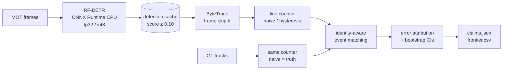

# video-analytics

> Detect, track and count people crossing a line on fixed-camera video, scored against annotated
> tracks on held-out sequences, with every counting error attributed and the CPU inference budget
> measured, not assumed.

[](https://github.com/Prithv122/video-analytics/actions/workflows/ci.yml)

**Live demo:** not deployed — runs locally on CPU.
**Stack:** Python 3.12 · RF-DETR (Apache-2.0) on ONNX Runtime · ByteTrack (`trackers`, Apache-2.0) ·
numpy/scipy counting core · motmetrics · pytest. No Ultralytics (AGPL-3.0).

**Result in one line:** on held-out crowded video the count is wrong because the detector misses
people, not because the tracker swaps them: recall ≤ 0.19 in every configuration, identity switches
≤ 5 % of errors, and a confidence threshold chosen on sparser scenes produced zero tracks on the
densest one. Three of four pre-registered claims were not supported; the fourth (int8 speed-up)
held, but its accuracy half passed for a different reason than predicted (§5).

---

## 1. The problem

Footfall counters, queue monitors and traffic counts all reduce to "how many tracks crossed this
line". A count is usually reported as one number per hour, and a number that matches the truth
looks right even when it isn't: a person the tracker missed and another person it counted twice
cancel out. Operators need to know how wrong the count is, why, and what they give up when they
run it on cheap hardware.

## 2. The data

| | |
|---|---|
| Source | [MOTChallenge](https://motchallenge.net): MOT17 (dev) and MOT20 (test), train splits, annotated track ids |
| Size | dev: 3 static-camera sequences, 2,175 frames; test: 4 sequences, 8,931 frames (about 3.6 GB fetched by range reads) |
| Licence | CC BY-NC-SA 3.0. Not redistributed: `vidan fetch` downloads it, `data/manifest.json` verifies it |
| Refresh | one-off |

Only static cameras are used: a line fixed in the image moves in the world when the camera moves.
Test sequences are different places and much denser crowds than dev. That shift is part of what
is measured.

## 3. Architecture



The counting core (`mot`, `geometry`, `counting`, `metrics`, `attribution`) is numpy and scipy
only and runs in CI without weights or video. The detector runs once per (config, sequence); every
tracking and counting experiment replays from the cache.

## 4. Key decisions & tradeoffs

| Decision | Chose | Over | Why |
|---|---|---|---|
| How a counting error is measured | identity-aware matching of crossing events | net count error | a net count is exact when a miss and a double count cancel; matching each crossing to the person who made it shows both |
| Truth | GT tracks through the same counter, naive rule | a separate truth counter | the counting rule can't masquerade as accuracy; a band that hides a real back-and-forth counts as an error |
| Line placement | frame midlines, generated before any prediction | lines drawn by eye | a line moved after seeing results is a tuned result |
| Evaluation | tune on MOT17, score once on MOT20, plan frozen first (`EVAL_PLAN.md`) | best-of-grid on one set | a pre-registered claim can fail, which is what makes it worth reporting |
| Detector | COCO-pretrained RF-DETR, no fine-tuning | YOLO via Ultralytics | AGPL-3.0; fine-tuning on MOT would blur the dev/test line |
| Speed claims | a quiet-machine CPU gate before every timed repeat | timing whenever | the first timings on a shared CPU swapped PyTorch and ONNX between runs |

## 5. Results

All numbers are from one scoring of the MOT20 test set with settings chosen on MOT17 dev
(`EVAL_PLAN.md`, amendments A1–A2 written before tuning). 2,115 true crossings on 8 lines.
Intervals are 95 % cluster-bootstrap over (sequence, 10 s block). Tables: `results/test_summary.csv`,
`claims.json`, `bench.csv`, `test_detector_scores.csv`.

### Pre-registered claims

| Claim | Verdict | Evidence |
|---|---|---|
| **H1** a net count hides error (`eer ≥ 1.5 × wape`) | **not supported** | `eer` 1.02 vs `wape` 0.94; `eer − 1.5·wape` −0.39 [−0.44, −0.33]. The count is not exact-but-wrong, it is far too low |
| **H2** hysteresis beats naive | **not supported** (reversed) | f1 0.057 vs 0.089, difference −0.032 [−0.052, −0.015] |
| **H3** int8 is a free speed-up | **supported**, with a caveat | Small int8 1.38× fp32 FPS (Nano 1.27×, not claimed); f1(S) − f1(S8) −0.074 [−0.100, −0.049]. The accuracy gain is most likely not int8 itself: dev picked τ 0.5 for S8 and 0.6 for S, and their test score percentiles differ by only 0.009–0.016 |
| **H4** ONNX Runtime ≥ 1.5× eager PyTorch | **not supported** | ONNX/PyTorch FPS 0.84 (Nano) and 0.70 (Small), and the box-equivalence check failed for both at score ≥ 0.10 (at 0.30 Nano passes; Small's minimum IoU is still 0.980) |

### What limits the count: the detector's confidence in a crowd

| Config, k = 1 | Arm | τ | f1 [95 % CI] | Precision | Recall | Switch share |
|---|---|---|---|---|---|---|
| Small fp32 (reference) | hysteresis | 0.6 | 0.057 [0.033, 0.088] | 0.40 | 0.03 | 0.002 |
| Small fp32 | naive | 0.6 | 0.089 [0.055, 0.130] | 0.24 | 0.05 | 0.020 |
| Small int8 | hysteresis | 0.5 | 0.131 [0.103, 0.165] | 0.42 | 0.08 | 0.006 |
| Nano fp32 | hysteresis | 0.5 | 0.158 [0.125, 0.195] | 0.34 | 0.10 | 0.013 |
| **Best cell**: Nano fp32, k = 2 | hysteresis | 0.4 | **0.268** [0.231, 0.309] | 0.44 | 0.19 | 0.026 |

- **Misses dominate.** In the reference cell 1,986 of 2,115 true crossings are `missed` (no track
  on one side of the line); identity switches account for 0.2 % of errors. Across all 32 cells the
  switch share never exceeds 5 % and recall never exceeds 0.19.
- **f1 tracks the selected threshold.** Across the 32 cells, the 20 at τ 0.6 score 0.04–0.10, the
  10 at τ 0.5 score 0.12–0.21 and the 2 at τ 0.4 score 0.22–0.27. This is an observation: τ was
  chosen per config, k and arm on dev, so it is confounded with all three, and τ was never varied
  on its own on the test set.
- **Why.** On MOT20-05 (195 annotated people per frame) Small's highest person score in 3,315 frames
  is 0.59, below the τ = 0.6 that dev chose, so ByteTrack never starts a track and both lines count
  zero. On MOT17-04 (dev) the same model's 90th-percentile score is 0.75; on MOT20-05 it is 0.31.
  The threshold failed silently: no error, just no output.
- **Dev looked different.** On MOT17 the main error was extra crossings: a person standing on the
  line (one track crossed 57 times) and box bottoms jumping when legs are occluded. The band removed
  most of the first kind, and dev f1 rose 0.31 → 0.46. On MOT20 there are too few tracks for that
  to matter.

### Speed (one CPU, gated)

Intel i7-8850H (6 cores / 12 threads), Windows 11, 12 threads, 100 frames of MOT17-04 at 1920×1080,
3 repeats; every repeat started only after system CPU stayed under 15 % for 10 s.

| Detector | Backend | ms/frame (median of means) | FPS |
|---|---|---|---|
| Nano fp32 | PyTorch | 270 | 3.70 |
| Nano fp32 | ONNX Runtime | 320 | 3.12 |
| Nano int8 | ONNX Runtime | 253 | 3.95 |
| Small fp32 | PyTorch | 433 | 2.31 |
| Small fp32 | ONNX Runtime | 623 | 1.61 |
| Small int8 | ONNX Runtime | 451 | 2.22 |

Tracking and counting take 1.1–1.2 ms per processed frame, so detection is over 99 % of the
pipeline. Frame skip k multiplies throughput by k; on this test set it did not cost accuracy
consistently because accuracy moved with τ instead. The frontier's "cheapest point within 0.02 f1
of the reference" (Nano, k = 5) is uninformative when the reference itself scores 0.057.

ONNX fp32 vs PyTorch boxes on 50 dev frames: mean matched IoU 0.9999 (Nano) and 0.9998 (Small),
but the minimum is 0.983 and 0.897, so the pre-registered all-boxes ≥ 0.99 rule fails (`equivalence.csv`).

### Limits

One CPU and one OS; the gate's 15 % system-wide allowance is about two busy logical cores. COCO
weights, never fine-tuned on crowds. MOTA/IDF1 in `test_mot.csv` keep predictions on
non-pedestrian annotations, so they are not leaderboard-comparable. Lines are frame midlines, a
fair rule rather than a realistic door or gate.

## 6. How to run

```bash
git clone https://github.com/Prithv122/video-analytics.git
cd video-analytics
uv sync --all-groups
uv run pytest -m "not integration"
```

The full pipeline needs the `vision` extra (PyTorch CPU, RF-DETR, ONNX Runtime) and about 4 GB of
data. Always pass `--extra vision`; a plain `uv run` re-syncs and removes it.

```bash
uv sync --all-groups --extra vision
uv run --extra vision vidan fetch --split all
uv run --extra vision vidan verify
uv run --extra vision vidan export --config S
uv run --extra vision vidan detect --config S --split all --threads 6
uv run --extra vision vidan eval tune
```

## 7. What I'd change at 100× scale

100× here means a few hundred cameras instead of one sequence at a time.

| Breaks first | Why | What I'd do |
|---|---|---|
| Detector cost | On this CPU detection takes 0.25–0.62 s per 1080p frame; tracking and counting take about 1 ms (§5) | Batch frames across cameras on a GPU inference server (Triton or ONNX Runtime with the CUDA provider), keep the CPU path for edge boxes; frame skip only where the dev curve says it costs nothing |
| The anchor | The bottom of a visible-part box is not a foot position: occlusion moves it by more than any band | Count on a keypoint model's ankle points, or on a ground-plane footprint from a calibrated homography, and track in world coordinates |
| One line per camera, placed by rule | Midlines are fair for a benchmark, not for a shop door | A per-camera config with the line drawn on the floor plan, plus a short labelled clip per camera to check it before it goes live |
| Truth | Annotated tracks exist for MOTChallenge only | A sampled audit: hand-count 5 minutes per camera per week and alert when event-level F1 drifts, since a net count can hide it |
| Storage | Caches are one `.npz` per sequence | Detections and crossings as Parquet partitioned by camera and hour, so recounting with a new rule never touches video |

---

## References

- Zhang et al., *ByteTrack: Multi-Object Tracking by Associating Every Detection Box*, ECCV 2022.
- Robinson et al., *RF-DETR* (Roboflow), Apache-2.0.
- Milan et al., *MOT16: A Benchmark for Multi-Object Tracking*, 2016; Dendorfer et al., *MOT20*, 2020.
- `py-motmetrics` for MOTA / IDF1 / ID switches (Bernardin & Stiefelhagen 2008; Ristani et al. 2016).
