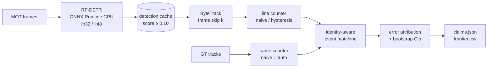

# video-analytics

> Detect, track and count people crossing a line on fixed-camera video, scored against annotated
> tracks on held-out sequences, with every counting error attributed and the CPU inference budget
> measured, not assumed.

[](https://github.com/Prithv122/video-analytics/actions/workflows/ci.yml)

**Live demo:** not deployed — runs locally on CPU.
**Stack:** Python 3.12 · RF-DETR (Apache-2.0) on ONNX Runtime · ByteTrack (`trackers`, Apache-2.0) ·
numpy/scipy counting core · motmetrics · pytest. No Ultralytics (AGPL-3.0).

**Status:** built and pre-registered; detection caching and the dev/test runs are in progress.
No result below is final until this line says so.

---

## 1. The problem

Footfall counters, queue monitors and traffic counts all reduce to "how many tracks crossed this
line". A count is usually reported as one number per hour, and a number that matches the truth
looks right even when it isn't: a person the tracker missed and another person it counted twice
cancel out. Operators need to know how wrong the count is, why, and what they give up when they
run it on cheap hardware.

## 2. The data

| | |
|---|---|
| Source | [MOTChallenge](https://motchallenge.net): MOT17 (dev) and MOT20 (test), train splits, annotated track ids |
| Size | dev: 3 static-camera sequences, 2,175 frames; test: 4 sequences, 8,931 frames (about 3.6 GB fetched by range reads) |
| Licence | CC BY-NC-SA 3.0. Not redistributed: `vidan fetch` downloads it, `data/manifest.json` verifies it |
| Refresh | one-off |

Only static cameras are used: a line fixed in the image moves in the world when the camera moves.
Test sequences are different places and much denser crowds than dev. That shift is part of what
is measured.

## 3. Architecture



The counting core (`mot`, `geometry`, `counting`, `metrics`, `attribution`) is numpy and scipy
only and runs in CI without weights or video. The detector runs once per (config, sequence); every
tracking and counting experiment replays from the cache.

## 4. Key decisions & tradeoffs

| Decision | Chose | Over | Why |
|---|---|---|---|
| How a counting error is measured | identity-aware matching of crossing events | net count error | a net count is exact when a miss and a double count cancel; matching each crossing to the person who made it shows both |
| Truth | GT tracks through the same counter, naive rule | a separate truth counter | the counting rule can't masquerade as accuracy; a band that hides a real back-and-forth counts as an error |
| Line placement | frame midlines, generated before any prediction | lines drawn by eye | a line moved after seeing results is a tuned result |
| Evaluation | tune on MOT17, score once on MOT20, plan frozen first (`EVAL_PLAN.md`) | best-of-grid on one set | a pre-registered claim can fail, which is what makes it worth reporting |
| Detector | COCO-pretrained RF-DETR, no fine-tuning | YOLO via Ultralytics | AGPL-3.0; fine-tuning on MOT would blur the dev/test line |
| Speed claims | a quiet-machine CPU gate before every timed repeat | timing whenever | the first timings on a shared CPU swapped PyTorch and ONNX between runs |

## 5. Results

_Not measured yet._ The equivalence check (ONNX fp32 vs PyTorch, 50 dev frames) is in
`results/equivalence.csv`; everything else waits for the detection caches.

## 6. How to run

```bash
git clone https://github.com/Prithv122/video-analytics.git
cd video-analytics
uv sync --all-groups
uv run pytest -m "not integration"
```

The full pipeline needs the `vision` extra (PyTorch CPU, RF-DETR, ONNX Runtime) and about 4 GB of
data. Always pass `--extra vision`; a plain `uv run` re-syncs and removes it.

```bash
uv sync --all-groups --extra vision
uv run --extra vision vidan fetch --split all
uv run --extra vision vidan verify
uv run --extra vision vidan export --config S
uv run --extra vision vidan detect --config S --split all --threads 6
uv run --extra vision vidan eval tune
```

## 7. What I'd change at 100× scale

_Written once the results are in._

---

## References

- Zhang et al., *ByteTrack: Multi-Object Tracking by Associating Every Detection Box*, ECCV 2022.
- Robinson et al., *RF-DETR* (Roboflow), Apache-2.0.
- Milan et al., *MOT16: A Benchmark for Multi-Object Tracking*, 2016; Dendorfer et al., *MOT20*, 2020.
- `py-motmetrics` for MOTA / IDF1 / ID switches (Bernardin & Stiefelhagen 2008; Ristani et al. 2016).
